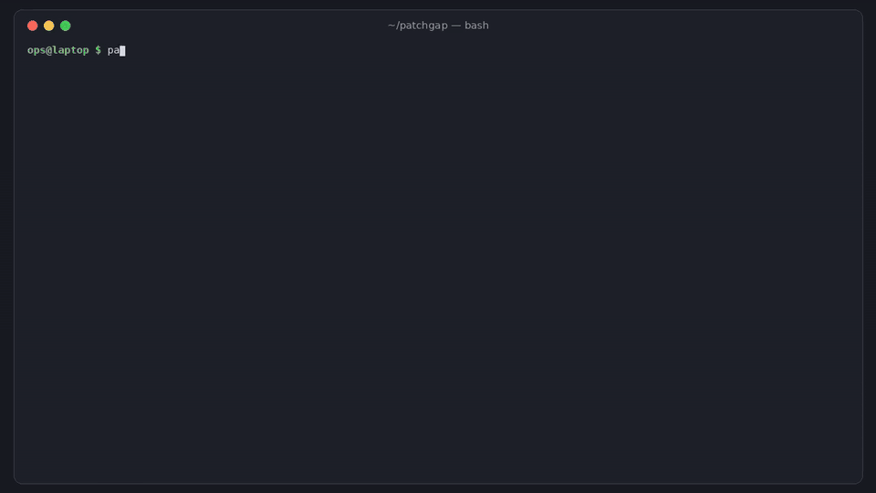

# patchgap

[](https://github.com/hamarshehmhmd/patchgap/actions/workflows/ci.yml)
[](LICENSE)

**A critical Linux CVE is public, Debian and Amazon Linux shipped the fix, and your distro hasn't. Now what?**

`patchgap` tells you which of your hosts are exposed *right now* (based on the kernel that's actually
running, not just what's installed). It applies the vetted, reversible stopgap for that CVE, dry-run first,
and removes it again once you've rebooted into a fixed kernel.



Full narrated demo: [demo.mp4](https://github.com/hamarshehmhmd/patchgap/releases/download/v0.1.0/demo.mp4)

## Why

- **CVE-2026-98432** (IPv4 TCP use-after-free, Red Hat: Critical, CVSS 9.8) went public on Oct 15 2026.
  Debian fixed it on Oct 16 and Red Hat and Amazon Linux shipped kernels by Nov 2. On Nov 3, Ubuntu's
  kernels for 22.04, 24.04 and 26.04 were still only in the `-proposed` pocket, and 20.04 and older had no fix
  at all ([HN: "WTF Ubuntu?"](https://news.ycombinator.com/item?id=50337608),
  [HN: "Ubuntu still has not released patch"](https://news.ycombinator.com/item?id=50341462)).
- In those threads, people were swapping iptables/nft one-liners, asking whether `-proposed` was safe, and
  checking by hand which boxes had actually rebooted.
- The stopgaps are documented (Red Hat's [RHSB-2026-016](https://access.redhat.com/security/vulnerabilities/RHSB-2026-016),
  Ubuntu's CVE page, AWS's bulletin), but they end up as ad-hoc rules that nobody removes later.

patchgap isn't a vulnerability scanner like Trivy, Vuls or OpenSCAP. It covers one short, urgent window:
*the few hot CVEs where your distro lags*. It answers which hosts are exposed, what the safe stopgap is,
whether it's in place, and when you can take it off.

## Install

```sh
curl -fsSL https://raw.githubusercontent.com/hamarshehmhmd/patchgap/main/install.sh | sh
```

The script uses `uv tool`, then `pipx`, then a private venv in `~/.local/share/patchgap`. Or install directly:

```sh
pipx install git+https://github.com/hamarshehmhmd/patchgap   # or: uv tool install git+https://github.com/hamarshehmhmd/patchgap
```

Needs Python 3.9+ and PyYAML. Target hosts scanned over ssh need nothing installed (just `sh`).

## Usage

```sh
patchgap check                          # this host: exit 0 safe, 1 exposed, 2 exposed but mitigated, 3 error
patchgap check --ssh web-1 --ssh db-1   # over ssh (runs a read-only sh script, BatchMode)
patchgap check --hosts hosts.txt --json # fleet, machine-readable, for CI/cron
patchgap inventory -o me.json           # save an inventory (e.g. inside a VM image build)
patchgap check -i me.json -i fleet.json # check saved inventories
patchgap status                         # this host + which mitigations are active / recorded

patchgap mitigate CVE-2026-98432        # dry run: prints what it would do, the trade-offs and sources
sudo patchgap mitigate CVE-2026-98432 --apply [--persist]
sudo patchgap cleanup                   # dry run: which mitigations are now safe to remove
sudo patchgap cleanup --apply           # remove them once the *running* system is fixed
sudo patchgap revert cve-2026-98432-nft --apply

patchgap list                           # CVEs and mitigations in the feed
patchgap feed update                    # fetch the latest feed (validated before it's cached)
```

What `check` reports for each host and CVE:

| state | meaning |
|---|---|
| `fixed` | running version is the fixed version or newer |
| `reboot-required` | fixed kernel is installed but you're still running the old one |
| `fix-available` | distro has released a fix; you haven't installed it |
| `fix-pending` | fix is built but only in a pre-release pocket (Ubuntu `-proposed`) |
| `no-fix` | distro lists the release as vulnerable with no fix |
| `not-affected` / `not-installed` | nothing to do |
| `unknown` | no feed data (e.g. Rocky/Alma, custom kernels). `--strict` makes this exit 1 |

### Example (from `examples/fleet/fleet.json`, made-up hosts with real distro versions)

```text
web-1  Ubuntu 24.04.3 LTS  kernel 6.8.0-117-generic
  CVE-2026-98432                     fix-pending                  fix 6.8.0-149.149 is only in proposed pocket
      mitigation cve-2026-98432-nft: active=no
web-2  Ubuntu 24.04.3 LTS  kernel 6.8.0-117-generic
  CVE-2026-98432                     fix-pending + MITIGATED      fix 6.8.0-149.149 is only in proposed pocket
api-1  Red Hat Enterprise Linux 9.8 (Plow)  kernel 5.14.0-611.54.1.el9_7.x86_64
  CVE-2026-98432                     reboot-required              fixed kernel 5.14.0-687.64.1.el9_8 installed; reboot into it
build-1  Amazon Linux 2023.9  kernel 6.1.168-203.330.amzn2023.x86_64
  CVE-2026-98432                     fix-available                update to 6.1.189-236.400.amzn2023
summary: fix-available=1, fix-pending=2, fixed=10, not-installed=1, reboot-required=1
exit 1: exposed hosts without an active mitigation
```

## The feed

[`src/patchgap/data/feed.yaml`](src/patchgap/data/feed.yaml) is generated by
[`scripts/build_feed.py`](scripts/build_feed.py). It reads the Debian security tracker, the Ubuntu CVE JSON
API, Red Hat's security data API and Amazon's ALAS pages, and **every fix entry stores the URL it came
from**. Nothing about fix status or versions is typed in by hand. The only hand-written part is
[`scripts/curated.yaml`](scripts/curated.yaml): which CVEs to track, and the mitigations, each with its own
sources.

The current feed covers CVE-2026-98432, CVE-2026-31431 ("Copy Fail") and CVE-2024-6387 ("regreSSHion")
for Debian, Ubuntu (including HWE and cloud kernels), RHEL and Amazon Linux. Rocky, Alma, SUSE etc. show
as `unknown` instead of being guessed from RHEL.

`patchgap feed update [--url URL]` validates a feed (schema, a source on every entry, a version on every
`fixed` entry) before caching it in `~/.cache/patchgap/`. Point `--url` at your own copy if you want to vet
updates first.

## Mitigations and safety

| CVE | mitigation | what it does | trade-off |
|---|---|---|---|
| CVE-2026-98432 | `cve-2026-98432-nft` | nft table dropping inbound IPv4 TCP with IP options (from RHSB-2026-016 / Ubuntu) | reduces, doesn't eliminate, exposure; per network namespace |
| CVE-2026-31431 | `cve-2026-31431-algif-aead` | `install algif_aead /bin/false` + unload (from copy.fail) | refused when the module is built in (e.g. RHEL 9/10) |
| CVE-2024-6387 | `cve-2024-6387-logingracetime` | sshd drop-in `LoginGraceTime 0` (from Qualys) | lets attackers exhaust MaxStartups (DoS) |

- **Dry-run by default.** Nothing changes without `--apply`, and `--apply` refuses to run unless you're root.
- **Validate first.** `nft -c` before loading, `sshd -t` before reloading (the drop-in is removed if
  the test fails), and module blocks are refused when the module is built in.
- **Verify after.** Each mitigation is checked live (`nft list table`, `sshd -T`, `modprobe -n -v`). If the
  check fails, it's rolled back.
- **Own files only.** It only writes `/etc/patchgap/*.nft`, `/etc/modprobe.d/patchgap-*.conf`,
  `/etc/ssh/sshd_config.d/00-patchgap-*.conf` and `/etc/sysctl.d/99-patchgap-*.conf`. `sshd_config` is
  never edited. `--persist` for nft adds one tagged `include` line to `/etc/nftables.conf`, and revert
  removes it.
- **State** lives in `/var/lib/patchgap/state.json`. `cleanup` removes a mitigation only when every CVE it
  covers is `fixed` in the running system. If a fixed kernel is installed but you haven't rebooted, the
  mitigation stays.

A stopgap is not a fix. Ubuntu's security team says kernel updates are the only appropriate mitigation for
CVE-2026-98432, and patchgap prints each mitigation's limits before applying it.

## Demo

`docs/demo.gif` (top of this page) runs `check` on the example fleet, then `mitigate` (dry run, then
`--apply` in a throwaway test root), `status` and `cleanup`. The narrated video is attached to the
[v0.1.0 release](https://github.com/hamarshehmhmd/patchgap/releases/tag/v0.1.0).

## Development

```sh
pip install -e . pytest && pytest -q
pip install beautifulsoup4 lxml && python scripts/build_feed.py   # refresh the feed from the trackers
```

The tests use a fake feed, a temp root and a fake command runner, so they never touch your system. CI
also runs the real nftables and module mitigations on a throwaway GitHub runner, applying and then
reverting them, and runs the inventory on Debian, Ubuntu, Amazon Linux and Rocky containers.

## License

GNU AGPL-3.0-or-later, see [LICENSE](LICENSE). Commercial licenses without the AGPL obligations are available
from the author, Mohammad Hamarsheh. Open an issue or contact [@hamarshehmhmd](https://github.com/hamarshehmhmd).
